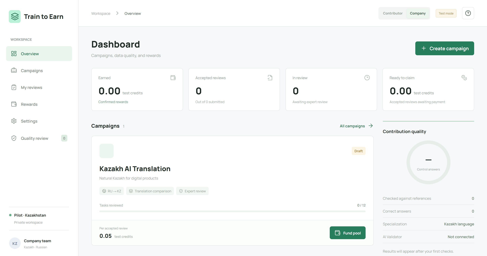
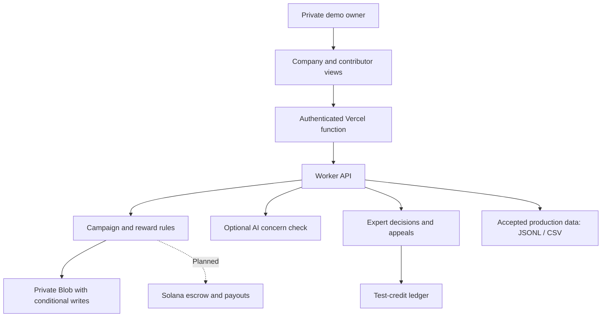

# Train to Earn

> A human-feedback workspace for AI teams: compare translations, verify contributions, export accepted data, and reward useful work.

[Live Demo](https://train-to-earn.vercel.app) | [Development Guide](docs/development.md) | [Source Code](https://github.com/diaqw/TrainToEarn)



## Project Overview

Train to Earn explores a marketplace where people and, eventually, AI agents contribute to AI training. The English-language MVP focuses on **Russian-to-Kazakh translation comparison**.

| Repository | Maintainer |
| --- | --- |
| [diaqw/TrainToEarn](https://github.com/diaqw/TrainToEarn) | [diaqw](https://github.com/diaqw) |

**Status:** Working private prototype on Vercel. Campaigns, reviews, hidden controls, expert decisions, appeals, exports, and a test-credit ledger are implemented. **Payments are simulated. No Solana program, wallet integration, or real USDC transfers are deployed.**

The hosted demo requires owner-provided credentials, which are not in this repository. The role switch demonstrates both sides of the workflow; it is not multi-user authorization.

## Problem and Solution

### 1. Completed Tasks Can Still Produce Poor Data

- **Problem:** Random answers and weak explanations reduce the usefulness of annotation.
- **Approach:** Contributors compare two translations and explain their choice. Hidden reference questions provide an additional quality signal.

### 2. Automated Judgments Need Oversight

- **Problem:** Model judges can be wrong on nuanced language tasks.
- **Approach:** Expert review handles production submissions. An optional AI adapter flags concerns but never authorizes rewards. Contributors can appeal a rejection once.

### 3. Rewards Must Remain Consistent

- **Problem:** Retries and concurrent requests can cause duplicate payments or lost updates.
- **Approach:** Integer accounting, reserved balances, and conditional storage writes protect the simulated ledger. Repeated claims cannot pay an already-paid submission again.

### 4. Buyers Need Usable Output

- **Problem:** Raw activity is not a training-ready deliverable.
- **Approach:** Export accepted production reviews as JSONL or CSV. Reference questions stay out of exports.

These are product hypotheses and engineering safeguards, not evidence of validated customer demand or measured model improvement.

## Why Solana

Solana is the **planned settlement layer**, not an implemented dependency of this MVP.

- Escrow could hold a buyer's funded reward pool.
- Authorized verification decisions could trigger contributor payouts.
- Transaction records could make reward distribution inspectable.
- A future reputation system could record verified contribution history.

A blockchain cannot prove whether an off-chain language judgment is correct. Validator authorization, disputes, wallet security, and independent contract testing must be designed before real payments.

## Summary of Features

- Company and contributor views in one private workspace.
- Campaign creation with JSON or JSONL dataset upload.
- Simulated funding and fixed rewards per accepted review.
- Four translation ratings with a written rationale.
- Hidden reference answers that never leave the task API.
- Human acceptance and rejection with notes and one appeal.
- Reward claims with duplicate-payment protection.
- JSONL and CSV export of accepted production feedback.
- Optional server-side AI review with expert fallback.
- Responsive English interface with Lucide icons.

## Tech Stack

| Layer | Technology |
| --- | --- |
| Frontend | Vanilla JavaScript, CSS, Lucide |
| Build | esbuild |
| API | Fetch-compatible JavaScript Worker |
| Vercel runtime | Node.js serverless function |
| Hosted storage | Private Vercel Blob with conditional writes |
| Local storage | Serialized JSON file adapter |
| Alternative hosting | Worker/R2-compatible storage contract |
| Optional AI | OpenAI API, server-side only |
| Tests | Node.js test runner |
| Planned settlement | Solana escrow and wallet signing |

## Architecture



All hosted state lives in one JSON object. This is a bounded pilot architecture, not a high-volume marketplace backend. Local and hosted datasets are separate.

## Quick Start

**Prerequisites:** Node.js 22+ and npm. No wallet or API key is required locally.

```sh
git clone https://github.com/diaqw/TrainToEarn.git
cd TrainToEarn
npm ci
npm run build
npm run dev
```

Open [http://127.0.0.1:4173](http://127.0.0.1:4173). Records persist in `.local/state.json`, which Git ignores. Rebuild and restart after changing source.

### Demo Walkthrough

1. Select **Company**. On a fresh installation, click **Fund pool**, then **Lock test budget** for the seeded campaign.
2. Switch to **Contributor → Campaigns → Start reviewing**.
3. Select a rating, explain it in at least 15 characters, and submit.
4. Switch to **Company → Quality review** to decide a pending submission.
5. Open **Contributor → Rewards** to claim accepted work.
6. Open campaign management to export accepted production reviews.

**No task available?** Draft campaigns require test funding first. Closed or completed campaigns cannot supply new tasks. The seed contains 12 demonstration tasks.

```sh
npm test
npm run build
npm run validate
```

See the [development guide](docs/development.md) for deployment, environment settings, dataset format, and API details.

## Verification

Tests cover accounting, duplicate claims, hidden references, appeals, closing rules, input validation, exports, concurrent writes, and the Vercel storage adapter. Browser checks have verified hosted test-pool activation, task loading, selection, and enabling submission after a rationale. These demonstrate software behavior, not linguistic accuracy or customer traction.

## Roadmap

- [x] Campaign creation and contributor reviews.
- [x] Reference questions, expert review, and appeals.
- [x] Consistent simulated reward ledger and dataset export.
- [x] Private English prototype deployed on Vercel.
- [ ] Paid pilots and measured cost per accepted result.
- [ ] Independent native-speaker quality evaluation.
- [ ] Evaluation of the optional live AI reviewer.
- [ ] Server-side roles and separate contributor identities.
- [ ] Independently tested Solana devnet escrow and wallet signing.
- [ ] Anti-abuse controls and calibrated reputation.
- [ ] Scalable storage before larger deployments.

## Limitations

Test credits have no monetary value. Seed translations are demonstration material, not linguist-certified ground truth. There is no model fine-tuning, calibrated reputation score, Sybil resistance, or independent contributor consensus. Live AI requires credentials and has not been validated against a linguistic benchmark.

The local server binds to loopback without a login. Hosted access uses one shared owner credential. Do not expose this as a public multi-user service without implementing authorization and a security review.

## Resources

- [Private Hosted Demo](https://train-to-earn.vercel.app)
- [GitHub Repository](https://github.com/diaqw/TrainToEarn)
- [Development Guide](docs/development.md)

## License

No project license has been selected. A license decision is pending.
